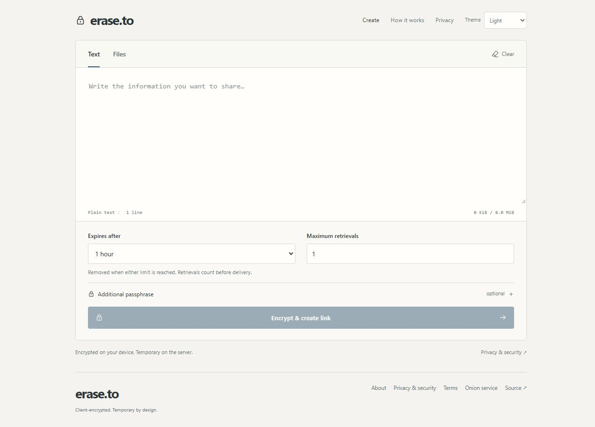
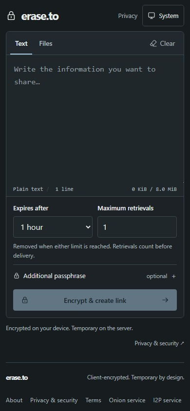
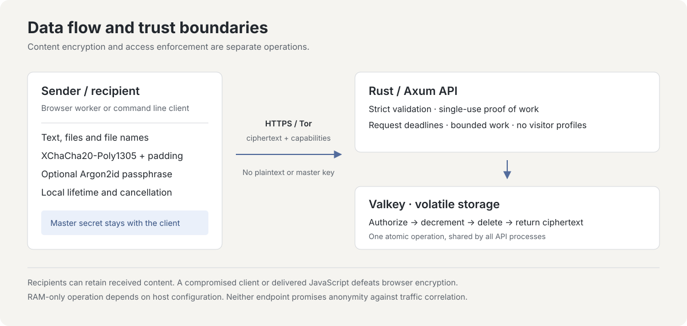

# erase.to

Text und Dateien verschlüsselt und vorübergehend weitergeben.

[English](README.md) · [Deutsch](README.de.md) · [Español](README.es.md) · [简体中文](README.zh-CN.md) · [Português (Brasil)](README.pt-BR.md)

[erase.to öffnen](https://erase.to/) · [Dokumentation](docs/README.md) · [Sicherheitsmodell](docs/threat-model.md) · [Selbst betreiben](docs/operations.md)

## Über das Projekt

erase.to ist ein Werkzeug für kurzlebige Kommunikation, entwickelt von RedCamel. Ich entwickle, pflege und betreibe es als unabhängiges Einpersonenprojekt. Eine Nachricht oder Datei soll bei dem Dienst, der sie übermittelt, nur für einen bewusst begrenzten Zeitraum verfügbar sein.

Ich möchte das private Weitergeben einfach halten: den Editor öffnen, eine Nachricht schreiben oder Dateien hinzufügen, festlegen, wann der Zugriff enden soll, und einen Link verschicken. Dafür musst du weder ein Konto erstellen noch eine Empfängeradresse eingeben oder eine Kontaktliste pflegen. Der Empfänger benötigt den vollständigen Link und, falls du eine festlegst, eine zusätzliche Passphrase.

Privatsphäre ist keine kostenpflichtige Zusatzfunktion. Der Dienst ist kostenlos und kommt ohne Werbung oder Analysedienste aus. Server und Domain bezahle ich aus eigener Tasche. Das Projekt zu unterstützen ist freiwillig und schaltet keine andere Schutzstufe frei.

Der Inhalt wird vor dem Hochladen auf deinem Gerät verschlüsselt. Der Server hält ein verschlüsseltes Paket in flüchtigem Speicher und setzt dessen Ablaufzeit und Abruflimit durch. Die Anwendung führt keine Zugriffsprotokolle oder Besucherprofile anhand von IP-Adressen. Die Oberfläche lädt keine Skripte, Schriftarten oder CDNs von Drittanbietern. So benötigt der Dienst für die Übergabe weniger gespeicherte Informationen.

Vorübergehende Speicherung hat Folgen. Sobald das Paket abläuft, widerrufen wird, sein Abruflimit erreicht oder bei einem Cache-Neustart verloren geht, kann ich es nicht für dich wiederherstellen. Ein Empfänger kann erhaltene Inhalte trotzdem speichern. Das Ziel ist, die Serverkopie und ihre Verfügbarkeit zu begrenzen; die Kontrolle über ein fremdes Gerät kann der Dienst nicht versprechen.

Ich veröffentliche den Quellcode und die Betriebsdokumentation, damit du diese Entscheidungen prüfen, ihre Grenzen verstehen und eine eigene Instanz betreiben kannst. Das Projekt soll verständlich bleiben: ein überschaubares Werkzeug für einen vorübergehenden Austausch, dessen Protokoll und Sicherheitsannahmen dokumentiert sind, statt hinter pauschalen Datenschutzversprechen zu verschwinden.

<picture>
  <source media="(prefers-color-scheme: dark)" srcset="docs/images/editor-dark.jpg">
  
</picture>

<details>
<summary>Mobile Ansicht</summary>



</details>

## Wann es nützlich ist

erase.to passt zu einem Austausch, bei dem der Empfänger etwas jetzt benötigt und der vermittelnde Dienst es nicht auf Dauer aufbewahren muss. Zum Beispiel:

- Einen vorübergehenden Zugangscode oder eine Konfigurationsangabe mit kurzer Gültigkeit weitergeben.
- Ein Dokument für einen einmaligen Abruf bereitstellen, ohne einen gemeinsamen Ordner oder ein Konto für den Empfänger anzulegen.
- Anweisungen und einige Dateien für eine bestimmte Aufgabe bündeln, mit derselben Ablaufzeit und demselben Abruflimit für das gesamte Paket.
- Ein Paket über die CLI im Terminal senden oder empfangen, mit demselben Verschlüsselungsformat wie im Browser.

Wähle Ablaufzeit und Abruflimit passend zum Austausch. Auch ein mehrfach abrufbares Paket läuft ab; auch ein einmaliges Paket braucht eine Gültigkeitsdauer. Behalte Originale, die du später benötigst, unter eigener Kontrolle. erase.to ist weder ein Backup noch ein dauerhaftes Dokumentenarchiv.

## Vom Schreiben zum Empfangen

1. **Paket vorbereiten.** Gib Text ein, füge Dateien hinzu oder kombiniere beides. Die Oberfläche zeigt die Gesamtgröße, damit du das Limit vor dem Senden prüfen kannst.
2. **Bedingungen festlegen.** Wähle Ablaufzeit und Anzahl berechtigter Abrufe. Ergänze eine Passphrase, wenn der Empfänger zusätzlich zum Link noch etwas benötigen soll.
3. **Erstellen und teilen.** Dein Gerät verschlüsselt das Paket vor dem Hochladen. Teile den erzeugten Link. Die Erstellungsseite hält eine separate Widerrufsmöglichkeit in der aktuellen Sitzung bereit; sie ist nicht im Empfängerlink enthalten. Halte diese Sitzung aktiv, wenn du die Serverkopie vorzeitig entfernen möchtest. Beim Leeren der Sitzung geht auch diese lokale Kontrolle verloren.
4. **Bewusst öffnen.** Das Aufrufen des Links prüft die Verfügbarkeit, ohne einen Abruf zu verbrauchen. Der Empfänger öffnet das Paket ausdrücklich. Eine erforderliche Passphrase wird vorher lokal geprüft, damit ein Tippfehler kein einmaliges Paket zerstört.
5. **Lesen oder herunterladen.** Der Inhalt wird auf dem Gerät des Empfängers entschlüsselt. Text erscheint als Text; Dateien werden zum Download angeboten und nicht automatisch geöffnet oder als Vorschau angezeigt.

Der Link enthält das zufällige Geheimnis, das zur Entschlüsselung benötigt wird. Behandle den vollständigen Link vertraulich und übermittle eine zusätzliche Passphrase über einen anderen Kanal, wenn du dich auf diese Trennung verlässt. Die Identität des Empfängers wird nicht geprüft: Wer den erforderlichen Link und die Passphrase besitzt, hat denselben Zugriff wie der vorgesehene Empfänger.

Der Absender kann ein Paket widerrufen, solange eine Serverkopie vorhanden ist. Bereits erfolgte Übertragungen lassen sich dadurch nicht zurückholen. Auch der Abrufzähler beschreibt Serverzugriffe und belegt nicht, dass jemand die Nachricht gelesen hat; eine abgebrochene Verbindung kann einen Abruf verbrauchen, bevor nutzbarer Inhalt ankommt.

## Funktionen

| Funktion | Verhalten |
| --- | --- |
| Text und Dateien | Bis zu **64 MiB insgesamt**, davon bis zu **8 MiB UTF-8-Text** und **8 Dateien**. Dateinamen und Medientypen sind verschlüsselt. |
| Verschlüsselung im Client | XChaCha20-Poly1305, ein zufälliges Linkgeheimnis und eine optionale Argon2id-Passphrase. Eine falsche Passphrase verbraucht keinen Abruf. |
| Begrenzte Verfügbarkeit | Ablaufzeit und Abruflimit gelten gleichzeitig. Berechtigungsprüfung, Zähleränderung und endgültige Löschung erfolgen atomar über API-Prozesse hinweg, die dieselbe maßgebliche Valkey-Instanz nutzen. |
| Kontrolle durch den Absender | Eine unabhängige Widerrufsberechtigung entfernt die verbleibende Serverkopie. Sie ist nicht im Link für den Empfänger enthalten. |
| Lokales Leeren | Manuelles Leeren, eine Frist von fünf Minuten Inaktivität mit 30 Sekunden Vorwarnung und Leeren entschlüsselter Inhalte beim Verbergen des Tabs. |
| Zugang und Betrieb | Browser- und Kommandozeilenclients, Zugang über Tor Browser oder [einen lokalen I2P-Router](docs/i2p.md) und eigener Betrieb mit Rust, Svelte und Valkey ohne Persistenz. |

## Privatsphäre während einer Sitzung

Der Browser hält Entwürfe, Schlüssel und entschlüsselte Inhalte in der aktiven Sitzung, statt sie als Nachrichtenverlauf zu speichern. Nach dem Neuladen stellt er Entwürfe oder Geheimnisse nicht automatisch wieder her. Die Empfängerseite entfernt Kennung und Geheimnis aus ihrer aktuellen URL, nachdem sie das Fragment gelesen hat. Bereits in einem Messenger, einer Zwischenablageverwaltung oder einer Browsererweiterung gespeicherte Kopien verschwinden dadurch nicht.

Du kannst die lokale Sitzung selbst leeren. Nach fünf Minuten Inaktivität entfernt die Seite sensible Zustände außerdem automatisch und warnt 30 Sekunden vorher. Wird ein Tab mit entschlüsseltem Inhalt verborgen, leert sich diese Ansicht. Das betrifft die lokale Seite: Weder die Ablaufzeit auf dem Server noch heruntergeladene Dateien oder Kopien in der Zwischenablage werden dadurch verändert.

Die Oberfläche folgt standardmäßig der hellen oder dunklen Darstellung deines Systems. Eine ausdrückliche Themenwahl kann lokal gespeichert werden; Nachrichten, Links und Schlüssel werden dort nicht absichtlich mitgespeichert. Für den Austausch sind weder Konto noch Cookie oder Trackingprofil erforderlich.

Das Erstellen eines Pakets erfordert einen an den Inhalt gebundenen Rechennachweis. Uploads verursachen damit Rechenaufwand, ohne einen Besucher anhand seiner IP-Adresse zu erfassen. Zusätzlich gelten globale Kapazitäts- und Ratenlimits. Ein ausgelasteter oder voller Dienst kann Anfragen daher ablehnen. Diese Maßnahmen garantieren keine Verfügbarkeit gegenüber jeder Art von Missbrauch.

## Lokal ausprobieren

Voraussetzung sind Git, Docker und Docker Compose:

```sh
git clone https://github.com/RedCamel1312/erase.to.git
cd erase.to
docker compose up --build -d
```

Öffne `http://127.0.0.1:3001`. Der Compose-Stack veröffentlicht ausschließlich diese Loopback-Adresse; Anwendung und Cache verwenden interne Netze. Beim Stoppen des Caches gehen seine Pakete verloren.

Für öffentlichen Betrieb folge der [Betriebsanleitung](docs/operations.md). Sie behandelt HTTPS beziehungsweise einen unterstützten Browserkontext für Onion-Dienste, Swap und Speicherabbilder, Proxy-Pufferung und die Prüfung des Hosts. Container allein belegen keinen ausschließlich flüchtigen Betrieb. Für die Arbeit am Quellcode gibt es die [Entwicklungsanleitung](docs/development.md). Die weiterführende technische Dokumentation ist auf Englisch.

## Grenzen, die du kennen solltest

Ich möchte die Grenzen genauso sichtbar machen wie die Funktionen. Ob eine Übergabe geeignet ist, hängt von deinem Gerät, dem Empfänger und dem Kanal ab, über den du den Zugriff teilst.

- Ein vollständiger Link gewährt Zugriff, sofern keine zusätzliche Passphrase verlangt wird. Schütze den Link und übermittle die Passphrase getrennt, wenn diese Trennung wichtig ist.
- Das Limit zählt berechtigte Abrufe, keine Personen oder erfolgreichen Übertragungen. Ein unterbrochener letzter Abruf kann das Paket verbrauchen. Empfänger können Kopien behalten; Widerruf und lokales Leeren können sie nicht entfernen.
- Cache-Neustarts verwerfen Pakete. Große Übertragungen puffern vollständige Pakete, können ein Mehrfaches der Inhaltsgröße im Arbeitsspeicher benötigen und müssen innerhalb begrenzter Fristen abgeschlossen sein.
- Verschlüsselung verbirgt nicht alle Metadaten und schützt kein kompromittiertes Gerät. Der Server sieht Zugriffsparameter und Transportinformationen; der Browser vertraut außerdem dem ausgelieferten Code. Quellcodeprüfung und Tests sind kein unabhängiges Sicherheitsaudit und keine Anonymitätsgarantie.

Das [Bedrohungsmodell](docs/threat-model.md) erläutert diese Grenzen im Detail.

<details>
<summary>So funktionieren Protokoll und Speicherung</summary>

### Verschlüsselung und Zugriff



Browser-Worker und CLI verwenden dasselbe versionierte Protokoll aus `shared/`. Ein zufälliges 256-Bit-Linkgeheimnis und eine 192-Bit-Nonce dienen der Verschlüsselung mit XChaCha20-Poly1305. Optionale Passphrasen verwenden Argon2id v1.3 mit 64 MiB Speicher und drei Durchläufen. Authentifizierte Metadaten binden die Regeln des Pakets an seinen Inhalt. Auffüllen auf 4-KiB-Gruppen verbirgt genaue Längen; die ungefähre Größe bleibt erkennbar.

Das Linkgeheimnis bleibt im URL-Fragment, das Browser nicht in HTTP-Anfragen mitsenden. Metadaten, Abruf und Widerruf nutzen getrennte Berechtigungen. Der Server erhält verschlüsselte Daten, öffentliche Protokollfelder, Zugriffsregeln, Berechtigungshashes und die für den jeweiligen Zugriff vorgelegte Berechtigung. Im normalen Protokoll erhält er weder Klartext noch ursprüngliche Dateinamen, Linkgeheimnis, Passphrase oder Entschlüsselungsschlüssel.

### Speicherung und Verbrauch

Die Rust-API prüft begrenzte Anfragen und einmalige, an das Paket gebundene Rechennachweise. Feste Valkey-Skripte koordinieren Ablauf, Verbrauch, Widerruf und Kapazität. Jedes Paket läuft ab; Persistenz und Verdrängung sind deaktiviert. Ist der Speicher voll, werden neue Uploads abgewiesen. Ein reiner API-Neustart kann Pakete erhalten, solange der Cache weiterläuft.

Einmalige Abrufe werden im maßgeblichen Cache koordiniert und nicht nur durch eine Sperre in einem einzelnen API-Prozess. Berechtigungsprüfung, Ablaufkontrolle, Zähleränderung und Löschung bilden einen atomaren Zustandswechsel. Diese Eigenschaft setzt eine einzelne primäre Valkey-Instanz voraus. Asynchrones Failover oder das Wiederherstellen alter Cachedaten braucht ein eigenes Konsistenzkonzept.

Der Server begrenzt Anfragegrößen, parallele Arbeit und Ausführungszeit. Einen möglicherweise bereits verbrauchten Abruf wiederholt er bei unklarem Ergebnis nicht automatisch. Betriebsmaßnahmen für Swap, Speicherabbilder, Persistenz und Proxy-Pufferung sind ebenso wichtig wie die Wahl eines Speichers im RAM.

Genaue Formate und Begründungen stehen in der [Protokollspezifikation](docs/protocol.md) und den [Entwurfsquellen](docs/research.md).

</details>

<details>
<summary>Entwicklung, Kommandozeile und Prüfung</summary>

Verwende Node 24 und die in `package.json` festgelegte pnpm-Version:

```sh
pnpm install --frozen-lockfile
pnpm check
pnpm test
pnpm build
pnpm cli help
```

Die [Entwicklungsanleitung](docs/development.md) behandelt Rust, eine isolierte Valkey-Instanz und den Entwicklungsserver für den Browser. Die [Testanleitung](docs/testing.md) beschreibt Prüfungen mit echtem Cache, mehreren Prozessen und vollständigen Nutzungsabläufen. Tests dürfen niemals einen Produktionscache verwenden.

Die [CLI-Anleitung](docs/cli.md) erklärt Senden, Empfangen, Passphraseneingabe und Widerruf. Vollständige Links, Nachrichtentexte und Passphrasen gehören nicht in Shell-Argumente oder die Historie. Die CLI unterstützt HTTPS und lokales HTTP zur Entwicklung; Tor- und I2P-Adressen weist sie vor der Namensauflösung ab. Verwende Tor Browser oder einen Browser mit deinem lokalen I2P-Proxy. Empfangene Dateien werden nie automatisch geöffnet oder als Vorschau angezeigt.

Die wichtigsten Quellverzeichnisse sind `web/` (Oberfläche), `shared/` (Protokoll und Kryptografie), `server/` (API und atomare Cache-Operationen), `cli/` und `deploy/`. Die CI prüft Anwendung, Verhalten mit echtem Cache und Produktionscontainer. Eine vollständige Übersicht bietet der [Dokumentationsindex](docs/README.md).

</details>

## Pflege des Projekts

Ich pflege sowohl die Anwendung als auch die Dokumentation. Der offene Quellcode ermöglicht anderen, die Umsetzung der Aussagen zu prüfen, Verbesserungen vorzuschlagen oder eine Instanz unter eigener Kontrolle zu betreiben. Er belegt für sich allein weder, welche Programmdateien ein gehosteter Dienst tatsächlich ausführt, noch macht er aus einer Testsammlung ein unabhängiges Audit.

Hilfreiche Beiträge sind nachvollziehbare Fehlerberichte, die Prüfung von Protokoll und Betriebsannahmen, Verbesserungen der Barrierefreiheit und Korrekturen dieser Übersetzungen. Ein reproduzierbares Beispiel mit erfundenen Daten hilft mir bei der Untersuchung, ohne deine privaten Inhalte einzusammeln. Die technischen Dokumente bleiben auf Englisch; die fünf Einführungen beschreiben dieselben Funktionen und Grenzen.

## Mitwirken oder ein Problem melden

Die [Hinweise zum Mitwirken](CONTRIBUTING.md) beschreiben Entwicklung und Prüfung. Melde Sicherheitslücken vertraulich über die [Sicherheitsrichtlinie](SECURITY.md). Verwende erfundene Beispiele; veröffentliche keine privaten Links, Nachrichten oder Zugriffsberechtigungen in Issues.

## Das Projekt unterstützen

Ich bezahle Server und Domain aus eigener Tasche. Wenn dir das Werkzeug hilft und du meine Arbeit sowie die laufenden Kosten unterstützen möchtest, freue ich mich über ein paar Sats. Die Nutzung bleibt kostenlos.

Bitcoin (BTC):

```text
bc1qddfz8u589nvh0gcxdqcz3yltracn9t9qq9jtm7
```

Erstellt von RedCamel. Veröffentlicht unter der [MIT-Lizenz](LICENSE). [Lizenzhinweise Dritter](THIRD_PARTY.md).
