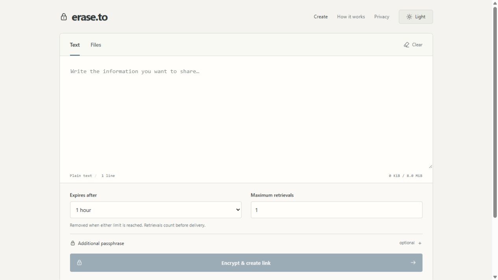
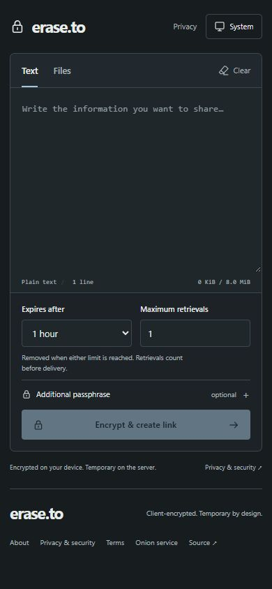
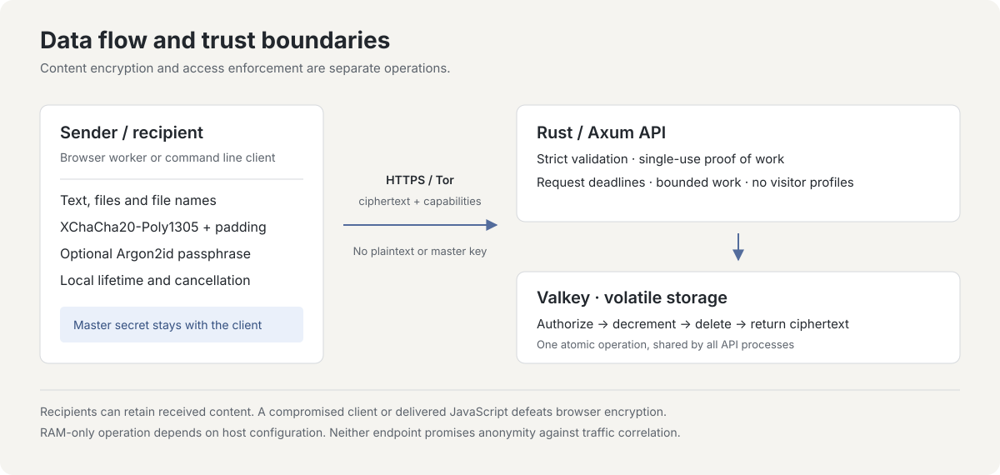

# erase.to

Comparte texto y archivos cifrados de forma temporal.

[English](README.md) · [Deutsch](README.de.md) · [Español](README.es.md) · [简体中文](README.zh-CN.md) · [Português (Brasil)](README.pt-BR.md)

[Abrir erase.to](https://erase.to/) · [Documentación](docs/README.md) · [Modelo de seguridad](docs/threat-model.md) · [Alojamiento propio](docs/operations.md)

## Acerca del proyecto

erase.to es una herramienta de comunicación efímera creada por RedCamel. La desarrollo, mantengo y opero como un proyecto independiente de una sola persona. Su propósito es que un mensaje o archivo solo permanezca disponible en el servicio de entrega durante un plazo breve que tú eliges.

Quiero que compartir algo en privado sea sencillo: abrir el editor, escribir un mensaje o adjuntar archivos, decidir cuándo debe terminar el acceso y enviar un enlace. No hay que crear una cuenta, introducir la dirección del destinatario ni mantener una lista de contactos. El destinatario necesita el enlace completo y, si la estableces, una frase de contraseña adicional.

La privacidad no es una función de pago. El servicio es gratuito, sin anuncios ni analítica. Pago el servidor y el dominio de mi propio bolsillo. Apoyar el proyecto es opcional y no desbloquea un nivel de protección diferente.

El contenido se cifra en tu dispositivo antes de subirlo. El servidor conserva un paquete cifrado en memoria volátil y aplica su caducidad y límite de recuperaciones. La aplicación no guarda registros de acceso ni perfiles de visitantes basados en su IP, y la interfaz no carga scripts, fuentes ni CDN de terceros. Estas decisiones reducen la información que el servicio necesita conservar para realizar una entrega.

El almacenamiento temporal tiene consecuencias. Cuando un paquete caduca, se revoca, alcanza su límite de recuperaciones o desaparece al reiniciar la caché, no puedo recuperarlo para ti. Un destinatario sí puede guardar lo que recibe. El objetivo es limitar la copia conservada por el servicio y su disponibilidad, no prometer control sobre el dispositivo de otra persona.

Publico el código y la documentación de operación para que puedas revisar esas decisiones, entender sus límites y ejecutar tu propia instancia. Quiero que el proyecto siga siendo comprensible: una herramienta centrada en el intercambio temporal, con el protocolo y los supuestos de seguridad documentados, en lugar de ocultos tras afirmaciones generales sobre privacidad.

<picture>
  <source media="(prefers-color-scheme: dark)" srcset="docs/images/editor-dark.jpg">
  
</picture>

<details>
<summary>Vista móvil</summary>



</details>

## Cuándo resulta útil

erase.to encaja en un intercambio en el que el destinatario necesita algo ahora y el servicio de entrega no tiene por qué conservarlo indefinidamente. Por ejemplo:

- Enviar un código de acceso temporal o un dato de configuración con una vida corta.
- Entregar un documento para una única recuperación, sin crear una carpeta compartida ni una cuenta para el destinatario.
- Agrupar instrucciones y algunos archivos para una tarea concreta, con la misma caducidad y límite de recuperaciones para todo el paquete.
- Enviar o recibir un paquete desde un terminal mediante la CLI, con el mismo formato de cifrado que el navegador.

Elige una caducidad y un número de recuperaciones adecuados al intercambio. Un paquete que permita varias recuperaciones también caduca; uno de un solo uso también necesita un plazo. Conserva bajo tu control los originales que vayas a necesitar después. erase.to no es una copia de seguridad ni un archivo documental permanente.

## De escribir a recibir

1. **Prepara el paquete.** Introduce texto, añade archivos o combina ambos. La interfaz muestra el tamaño conjunto para que puedas comprobar el límite antes de enviar.
2. **Elige las condiciones.** Define la caducidad y el número de recuperaciones autorizadas. Añade una frase de contraseña si quieres que el destinatario necesite algo además del enlace.
3. **Crea y comparte.** Tu dispositivo cifra el paquete antes de subirlo. Comparte el enlace generado. La página de creación mantiene un control de revocación separado en la sesión actual; no se incluye en el enlace del destinatario. Mantén esa sesión activa si quieres retirar antes la copia del servidor. Al limpiar la sesión también se pierde ese control local.
4. **Abre de forma explícita.** Seguir el enlace comprueba la disponibilidad sin consumir una recuperación. El destinatario decide abrir el paquete. Si se exige una frase de contraseña, se comprueba primero de forma local para que un error de escritura no destruya un paquete de un solo uso.
5. **Lee o descarga.** El contenido se descifra en el dispositivo del destinatario. El texto se muestra como texto; los archivos se ofrecen para descarga y no se abren ni se previsualizan automáticamente.

El enlace contiene el secreto aleatorio necesario para descifrar. Trata el enlace completo como privado y comparte la frase adicional por otro canal cuando tu protección dependa de esa separación. No se comprueba la identidad del destinatario: quien tenga el enlace y la frase necesarios dispone del mismo acceso que la persona prevista.

El remitente puede revocar un paquete mientras quede una copia en el servidor. La revocación no puede deshacer una entrega anterior. Del mismo modo, el contador describe accesos al servidor, no demuestra que alguien haya leído el mensaje; una conexión fallida puede consumir una recuperación antes de que llegue contenido utilizable.

## Funciones

| Función | Comportamiento |
| --- | --- |
| Texto y archivos | Hasta **64 MiB en total**, incluidos hasta **8 MiB de texto UTF-8** y **8 archivos**. Los nombres y tipos de medios de los archivos están cifrados. |
| Cifrado en el cliente | XChaCha20-Poly1305, un secreto aleatorio en el enlace y una frase de contraseña opcional con Argon2id. Una frase incorrecta no consume una recuperación. |
| Disponibilidad limitada | La caducidad y el número de recuperaciones se aplican a la vez. La autorización, los cambios del contador y el borrado final son atómicos entre los procesos de API que comparten una instancia primaria de Valkey. |
| Control del remitente | Una autorización independiente de revocación elimina la copia restante del servidor. No se incluye en el enlace del destinatario. |
| Limpieza local | Borrado manual, un plazo de cinco minutos de inactividad con un aviso 30 segundos antes y borrado del contenido descifrado al ocultar la pestaña. |
| Acceso y funcionamiento | Clientes web y de línea de comandos, acceso onion opcional mediante Tor Browser y alojamiento propio con Rust, Svelte y Valkey sin persistencia. |

## Privacidad durante una sesión

El navegador mantiene los borradores, las claves y el contenido descifrado en la sesión activa, en lugar de guardarlos en un historial de mensajes. No restaura automáticamente un borrador o secreto tras recargar la página. La página receptora elimina el identificador y el secreto de su URL actual después de leer el fragmento; esto no elimina las copias que ya conserve una aplicación de mensajería, un gestor del portapapeles o una extensión del navegador.

Puedes limpiar la sesión local por tu cuenta. Tras cinco minutos de inactividad, la página también borra el estado sensible, con un aviso 30 segundos antes. Ocultar una pestaña que muestra contenido descifrado limpia esa vista. Estas acciones afectan a la página local: no cambian la caducidad del servidor ni eliminan archivos descargados o copias del portapapeles.

La interfaz sigue por defecto la preferencia clara u oscura de tu sistema. Una elección explícita de tema puede guardarse localmente; los mensajes, enlaces y claves no se almacenan allí de forma intencionada. El intercambio no necesita cuentas, cookies ni perfiles de seguimiento.

Crear un paquete requiere una prueba de trabajo vinculada a su contenido. Esto añade un coste de cálculo a las subidas sin crear un registro del visitante alrededor de su IP. También hay límites globales de capacidad y frecuencia, por lo que un servicio ocupado o lleno puede rechazar peticiones. Estos controles no garantizan disponibilidad frente a toda forma de abuso.

## Probar una instancia local

Con Git, Docker y Docker Compose instalados:

```sh
git clone https://github.com/RedCamel1312/erase.to.git
cd erase.to
docker compose up --build -d
```

Abre `http://127.0.0.1:3001`. Compose publica únicamente esa dirección de bucle local; la aplicación y la caché utilizan redes internas. Detener la caché descarta sus paquetes.

Para un servicio público, sigue la [guía de operaciones](docs/operations.md), que cubre HTTPS o un contexto de navegador compatible con servicios onion, controles de swap y volcados de memoria, búferes del proxy y verificación del host. Los contenedores por sí solos no garantizan un funcionamiento exclusivamente en RAM. Para trabajar con el código, consulta la [guía de desarrollo](docs/development.md). La documentación técnica detallada está en inglés.

## Límites que conviene conocer

Quiero que los límites sean tan visibles como las funciones. Que una entrega sea apropiada depende de tu dispositivo, de quien la recibe y del canal por el que compartes el acceso.

- Un enlace completo concede acceso salvo que se exija una frase de contraseña adicional. Protege el enlace y comparte la frase por separado cuando esa separación sea importante.
- El contador limita las recuperaciones autorizadas, no las personas ni las entregas correctas. Una última recuperación interrumpida puede consumir el paquete. Los destinatarios pueden conservar copias; la revocación y la limpieza local no las eliminan.
- Reiniciar la caché descarta los paquetes. Las transferencias grandes mantienen paquetes completos en memoria, pueden necesitar varias veces el tamaño del contenido y deben terminar dentro de plazos limitados.
- El cifrado no oculta todos los metadatos ni protege un dispositivo comprometido. El servidor ve parámetros de acceso e información de transporte; el navegador también confía en el código que recibe. Revisar el código y superar pruebas no equivale a una auditoría de seguridad independiente ni garantiza el anonimato.

El [modelo de amenazas](docs/threat-model.md) explica estos límites en detalle.

<details>
<summary>Cómo funcionan el protocolo y el almacenamiento</summary>

### Cifrado y acceso



El worker del navegador y la CLI comparten el protocolo versionado de `shared/`. Un secreto aleatorio de 256 bits en el enlace y un nonce de 192 bits permiten el cifrado XChaCha20-Poly1305. Las frases opcionales usan Argon2id v1.3 con 64 MiB de memoria y tres pasadas. Los metadatos autenticados vinculan las reglas del paquete con su contenido; el relleno en bloques de 4 KiB oculta las longitudes exactas, aunque el tamaño aproximado sigue siendo visible.

El secreto del enlace permanece en el fragmento de la URL, que los navegadores omiten en las peticiones HTTP. Los metadatos, la recuperación y la revocación utilizan autorizaciones separadas. El servidor recibe datos cifrados, campos públicos del protocolo, reglas de acceso, hashes de las autorizaciones y la autorización presentada en cada acceso; en el protocolo normal no recibe el texto en claro, los nombres originales, el secreto del enlace, la frase de contraseña ni la clave de descifrado.

### Almacenamiento y consumo

La API Rust valida peticiones acotadas y pruebas de trabajo de un solo uso vinculadas al paquete. Scripts fijos de Valkey coordinan caducidad, consumo, revocación y capacidad. Todos los paquetes caducan, la persistencia y la expulsión están desactivadas y se rechazan nuevas subidas cuando se llena la capacidad. Reiniciar solo la API puede conservar los paquetes si la caché sigue funcionando.

El uso único se coordina en la caché autoritativa, no mediante un bloqueo dentro de un solo proceso de API. Autorización, caducidad, cambios del contador y borrado forman una transición atómica. Esta propiedad presupone una única instancia primaria de Valkey; añadir conmutación asíncrona o restaurar datos antiguos de la caché requiere un diseño de consistencia aparte.

El servidor limita los tamaños de las peticiones, el trabajo simultáneo y el tiempo de ejecución, y no reintenta automáticamente una operación de consumo cuyo resultado sea incierto. Los controles de swap, volcados, persistencia y búferes del proxy importan tanto como elegir un almacén en memoria.

Consulta la [especificación del protocolo](docs/protocol.md) y las [fuentes del diseño](docs/research.md) para conocer los formatos exactos y sus motivos.

</details>

<details>
<summary>Desarrollo, línea de comandos y verificación</summary>

Usa Node 24 y la versión de pnpm fijada en `package.json`:

```sh
pnpm install --frozen-lockfile
pnpm check
pnpm test
pnpm build
pnpm cli help
```

La [guía de desarrollo](docs/development.md) cubre Rust, una instancia aislada de Valkey y el servidor de desarrollo del navegador. La [guía de pruebas](docs/testing.md) explica las comprobaciones con caché real, varios procesos y flujos completos. Las pruebas nunca deben usar una caché de producción.

La [guía de la CLI](docs/cli.md) explica el envío, la recepción, la entrada de frases de contraseña y la revocación. No pongas enlaces completos, mensajes ni frases de contraseña en los argumentos o el historial de la shell. La CLI admite HTTPS y HTTP local para desarrollo; rechaza direcciones onion porque no incorpora transporte Tor. Utiliza Tor Browser para acceder por onion. Los archivos recibidos nunca se abren ni se previsualizan automáticamente.

Los directorios principales son `web/` (interfaz), `shared/` (protocolo y criptografía), `server/` (API y operaciones atómicas de caché), `cli/` y `deploy/`. La CI comprueba la aplicación, su comportamiento con caché real y el contenedor de producción. El [índice de documentación](docs/README.md) ofrece el mapa completo.

</details>

## Mantenimiento del proyecto

Mantengo tanto la aplicación como la documentación. Publicar el código permite examinar cómo se implementan las afirmaciones, proponer mejoras o ejecutar una instancia bajo control propio. Por sí solo, no demuestra qué archivos de programa ejecuta un servicio alojado ni convierte un conjunto de pruebas en una auditoría independiente.

Son útiles los informes de errores claros, la revisión del protocolo y los supuestos de despliegue, las mejoras de accesibilidad y las correcciones de estas traducciones. Un informe con un ejemplo ficticio y reproducible me ayuda a investigar sin recopilar tu contenido privado. Los documentos técnicos siguen en inglés; las cinco introducciones describen las mismas funciones y límites.

## Contribuir o comunicar un problema

La [guía de contribución](CONTRIBUTING.md) cubre desarrollo y revisión. Comunica las vulnerabilidades en privado mediante la [política de seguridad](SECURITY.md). Usa ejemplos ficticios; no publiques enlaces privados, mensajes ni autorizaciones de acceso en las incidencias.

## Apoyar el proyecto

Pago el servidor y el dominio de mi propio bolsillo. Si esta herramienta te resulta útil y quieres apoyar mi trabajo y los gastos de funcionamiento, puedes contribuir con algunos sats. El servicio sigue siendo gratuito.

Bitcoin (BTC):

```text
bc1qddfz8u589nvh0gcxdqcz3yltracn9t9qq9jtm7
```

Creado por RedCamel. Publicado bajo la [licencia MIT](LICENSE). [Avisos de terceros](THIRD_PARTY.md).
