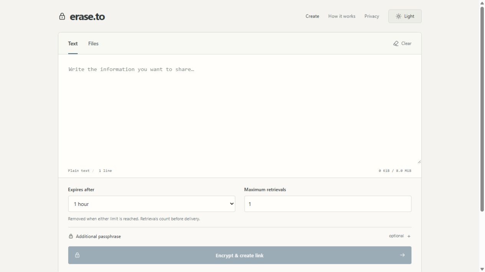
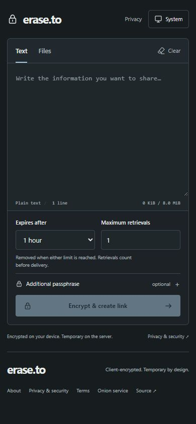
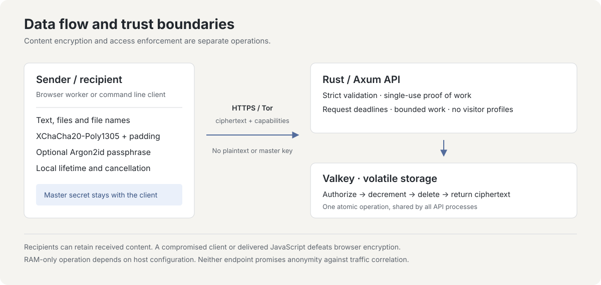

# erase.to

Encrypted, temporary handoffs for text and files.

[English](README.md) · [Deutsch](README.de.md) · [Español](README.es.md) · [简体中文](README.zh-CN.md) · [Português (Brasil)](README.pt-BR.md)

[Open erase.to](https://erase.to/) · [Documentation](docs/README.md) · [Security model](docs/threat-model.md) · [Self-hosting](docs/operations.md)

## About the project

erase.to is an ephemeral communication tool designed by RedCamel. I develop, maintain and run it as an independent, one-person project. Its purpose is to give a message or a file a short, deliberate lifetime on the service that delivers it.

I want sharing something privately to be straightforward: open the editor, write a message or attach files, decide when access should end, and send a link. There is no account to create, recipient address to enter or contact list to maintain. The recipient needs the full link and, if you set one, an additional passphrase.

Privacy is not a premium feature. The service is free, with no ads or analytics. I pay for the server and domain out of my own pocket. Supporting the project is optional; it does not unlock a different level of protection.

The content is encrypted on your device before it is uploaded. The server holds an encrypted package in volatile memory and enforces its expiry and retrieval limit. The application keeps no access logs or IP-based visitor profiles, and the interface loads no third-party scripts, fonts or CDNs. These choices reduce what the service needs to retain while it handles a handoff.

Temporary storage has consequences. Once the package expires, is revoked, reaches its retrieval limit or disappears in a cache restart, I cannot recover it for you. A recipient can still save what they receive. The aim is to limit the service's retained copy and its availability, not to promise control over someone else's device.

I publish the source and the operational documentation so that you can inspect those choices, understand their limits and run your own instance. I want the project to remain understandable: a focused tool for a temporary exchange, with its protocol and security assumptions written down rather than hidden behind broad privacy claims.

<picture>
  <source media="(prefers-color-scheme: dark)" srcset="docs/images/editor-dark.jpg">
  
</picture>

<details>
<summary>Mobile view</summary>



</details>

## When it is useful

erase.to fits an exchange where the recipient needs something now and the delivery service does not need to keep it indefinitely. For example:

- Send a temporary access code or a configuration detail with a short lifetime.
- Hand a document to someone for a single retrieval, without creating a shared folder or an account for them.
- Bundle instructions and a few files for a specific task, with the same expiry and retrieval limit for the whole package.
- Send or receive a package from a terminal using the CLI and the same encryption format as the browser.

Choose a lifetime and retrieval count that fit the exchange. A package with several allowed retrievals still expires; a one-time package still needs a lifetime. Keep any original that you need later under your own control. erase.to is not a backup or a permanent document store.

## From writing to receiving

1. **Prepare the package.** Enter text, add files, or combine both. The interface shows the combined size so you can check the limit before sending.
2. **Choose the conditions.** Set the expiry and number of authorized retrievals. Add a passphrase if you want the recipient to need something beyond the link.
3. **Create and share.** Your device encrypts the package before uploading it. Share the generated link. The creation page keeps a separate revocation control in the current session; it is not included in the recipient's link. Keep that session active if you want to remove the server copy early. Clearing the session also removes this local control.
4. **Open deliberately.** Following the link checks availability without consuming a retrieval. The recipient explicitly opens the package. A required passphrase is checked locally first, so a typo does not destroy a one-time package.
5. **Read or download.** Content is decrypted on the recipient's device. Text is displayed as text; files are offered for download and are not automatically opened or previewed.

The link contains the random secret needed for decryption. Treat the complete link as private, and share an additional passphrase through a separate channel when you rely on that separation. There is no recipient identity check: someone with the required link and passphrase has the same access as the intended recipient.

The sender can revoke a package while a server copy remains. Revocation cannot retract an earlier delivery. Similarly, the retrieval count describes server access, not proof that a person read the message; a failed connection can consume a retrieval before usable content arrives.

## What it does

| Feature | Behavior |
| --- | --- |
| Text and files | Up to **64 MiB total**, including up to **8 MiB of UTF-8 text** and **8 files**. File names and media types are encrypted. |
| Client encryption | XChaCha20-Poly1305, a random link secret and an optional Argon2id passphrase. A wrong passphrase does not consume a retrieval. |
| Limited availability | Expiry and retrieval count apply together. Authorization, count changes and final deletion are atomic across API processes sharing one Valkey primary. |
| Sender control | An independent revocation capability removes the remaining server copy. It is not included in the recipient's link. |
| Local cleanup | Manual clearing, a five-minute inactivity deadline with a 30-second warning, and clearing of decrypted content when the tab is hidden. |
| Access and operation | Browser and CLI clients, optional Tor onion access in Tor Browser, and self-hosting with Rust, Svelte and non-persistent Valkey. |

## Privacy during a session

The browser keeps drafts, keys and decrypted content in the active session rather than saving them as a message history. It does not automatically restore a draft or secret after a reload. The recipient page removes the identifier and secret from its current URL after reading the fragment; this does not remove copies already held by a messenger, clipboard manager or browser extension.

You can clear the local session yourself. After five minutes of inactivity, the page also clears sensitive state, with a warning 30 seconds beforehand. Hiding a tab that is displaying decrypted content clears that view. These actions affect the local page; they neither change the server's expiry nor erase downloaded files or clipboard copies.

The interface follows your system's light or dark preference by default. An explicit theme choice may be saved locally; messages, links and keys are not intentionally stored alongside it. No account, cookie or tracking profile is needed for the exchange.

Creating a package requires a payload-bound proof of work. This adds a computational cost to uploads without building a visitor record around an IP address. Global capacity and rate limits also apply, so a busy or full service can reject a request. These controls do not guarantee availability against every form of abuse.

## Try a local instance

With Git, Docker and Docker Compose installed:

```sh
git clone https://github.com/RedCamel1312/erase.to.git
cd erase.to
docker compose up --build -d
```

Open `http://127.0.0.1:3001`. The Compose stack publishes only that loopback address; the application and cache use internal networks. Stopping the cache discards its packages.

For public hosting, follow the [operations guide](docs/operations.md), including HTTPS or a supported onion-service browser context, swap and core-dump controls, proxy buffering and host verification. Containers alone do not establish RAM-only operation. For source development, use the [development guide](docs/development.md).

## Limits worth understanding

I want the limitations to be as visible as the features. Whether a handoff is appropriate depends on your device, the person receiving it and the channel used to share access.

- A full link grants access unless an additional passphrase is required. Protect the link, and share the passphrase separately when that separation matters.
- The count limits authorized retrievals, not people or successful deliveries. An interrupted final retrieval can consume the package. Recipients can keep copies; revocation and local cleanup cannot remove them.
- Cache restarts discard packages. Large transfers buffer complete packages, can require several times their content size in memory and must finish within bounded deadlines.
- Encryption does not hide all metadata or protect a compromised device. The server sees access parameters and transport information; the browser also trusts the code it receives. Source review and tests are not an independent security audit or a guarantee of anonymity.

The [threat model](docs/threat-model.md) explains these boundaries in detail.

<details>
<summary>How the protocol and storage work</summary>

### Encryption and access



The browser worker and CLI share the versioned protocol in `shared/`. A random 256-bit link secret and a 192-bit nonce support XChaCha20-Poly1305 encryption. Optional passphrases use Argon2id v1.3 with 64 MiB of memory and three passes. Authenticated metadata binds the package's policy to its content; 4 KiB padding buckets conceal exact lengths, while approximate sizes remain visible.

The link secret stays in the URL fragment, which browsers omit from HTTP requests. Metadata, retrieval and revocation use separate capabilities. The server receives ciphertext, public protocol fields, policy, capability hashes and the capability presented for each access; it does not receive the plaintext, original file names, link secret, passphrase or decryption key in the normal protocol.

### Storage and consumption

The Rust API validates bounded requests and payload-bound, single-use proof of work. Fixed Valkey scripts coordinate expiry, consumption, revocation and capacity. Every package expires, persistence and eviction are disabled, and full capacity rejects new uploads. An API-only restart can preserve packages while the cache remains running.

Single-use behavior is coordinated in the authoritative cache, rather than by a lock inside one API process. Authorization, expiry, counter changes and deletion are one atomic transition. This property assumes one Valkey primary; adding asynchronous failover or restoring old cache data needs a separate consistency design.

The server bounds request sizes, concurrent work and execution time, and it does not automatically retry an ambiguous consuming operation. Operational controls for swap, dumps, persistence and proxy buffering matter as much as choosing an in-memory store.

See the [protocol specification](docs/protocol.md) and [design sources](docs/research.md) for exact formats and rationale.

</details>

<details>
<summary>Development, command line and verification</summary>

Use Node 24 and the pnpm version pinned in `package.json`:

```sh
pnpm install --frozen-lockfile
pnpm check
pnpm test
pnpm build
pnpm cli help
```

The [development guide](docs/development.md) covers Rust, an isolated Valkey instance and the browser development server. The [testing guide](docs/testing.md) covers real-cache, multi-process and end-to-end checks. Tests must never use a production cache.

The [CLI guide](docs/cli.md) explains sending, receiving, passphrase input and revocation. Keep full links, message text and passphrases out of shell arguments and history. The CLI supports HTTPS and local development HTTP; it rejects onion addresses because it has no Tor transport. Use Tor Browser for onion access. Received files are never automatically opened or previewed.

The main source directories are `web/` (interface), `shared/` (protocol and cryptography), `server/` (API and atomic cache operations), `cli/` and `deploy/`. CI checks the application, real-cache behavior and the production container. See the [documentation index](docs/README.md) for the full map.

</details>

## Maintaining the project

I maintain both the application and the documentation. Publishing the source lets others examine how the claims are implemented, suggest improvements or run an instance under their own control. It does not, by itself, prove which bytes a hosted service is running or turn a test suite into an independent audit.

Useful contributions include clear bug reports, review of the protocol and deployment assumptions, accessibility improvements, and corrections to these translations. A report with a reproducible synthetic example helps me investigate without collecting your private content. The technical documents remain in English; the five introductions describe the same features and boundaries.

## Contribute or report a problem

[Contributing](CONTRIBUTING.md) covers development and review. Report vulnerabilities privately through [the security policy](SECURITY.md). Use synthetic examples; do not post private links, messages or access capabilities in issues.

## Support the project

I pay for the server and domain out of my own pocket. If this tool is useful to you and you want to support my work and the running costs, you can contribute some sats. The service remains free to use.

Bitcoin (BTC):

```text
bc1qddfz8u589nvh0gcxdqcz3yltracn9t9qq9jtm7
```

Created by RedCamel. Licensed under [MIT](LICENSE). [Third-party notices](THIRD_PARTY.md).
