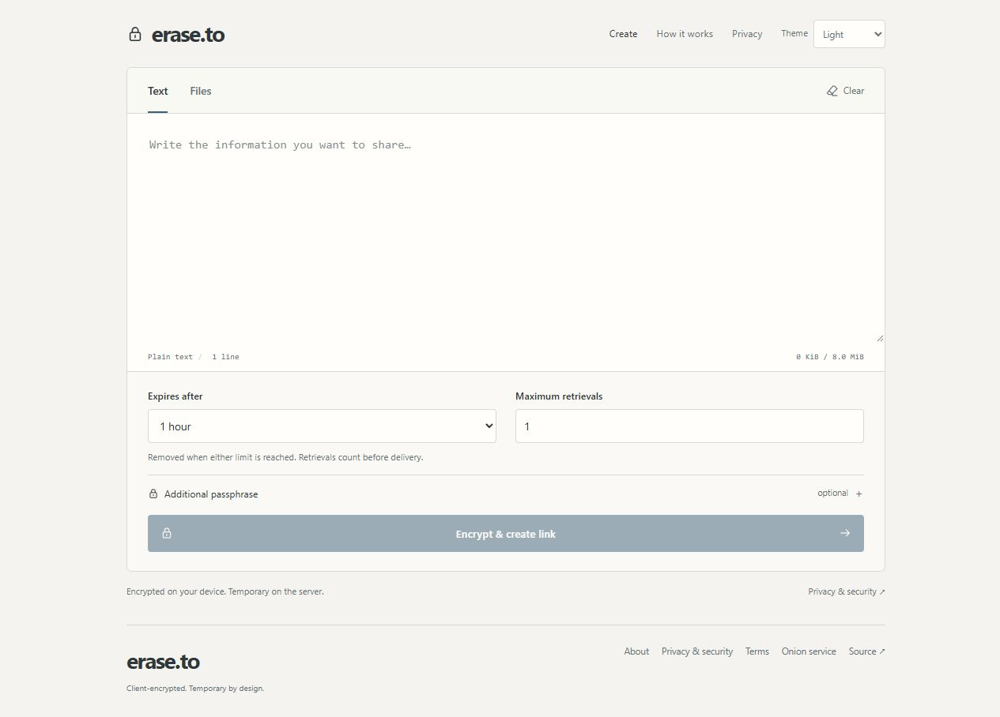
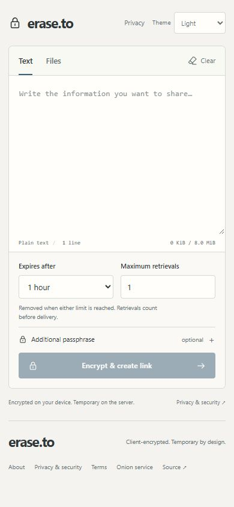
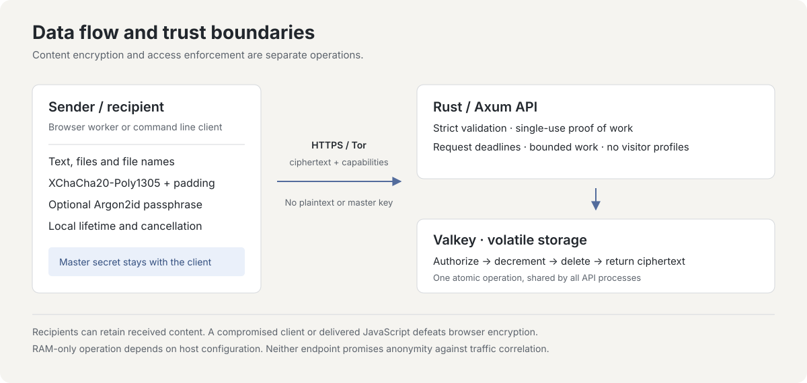

# erase.to

Compartilhe textos e arquivos criptografados de forma temporária.

[English](README.md) · [Deutsch](README.de.md) · [Español](README.es.md) · [简体中文](README.zh-CN.md) · [Português (Brasil)](README.pt-BR.md)

[Abrir erase.to](https://erase.to/) · [Documentação](docs/README.md) · [Modelo de segurança](docs/threat-model.md) · [Hospedagem própria](docs/operations.md)

erase.to é uma ferramenta de comunicação efêmera criada por RedCamel. Eu a desenvolvo e opero como um projeto independente, mantido por uma só pessoa.

Privacidade não é um recurso pago. O serviço é gratuito, sem contas, anúncios ou ferramentas de análise. O conteúdo é criptografado no seu dispositivo antes do envio; o servidor mantém os pacotes criptografados em memória volátil. A aplicação não mantém logs de acesso nem perfis de visitantes baseados em IP, e a interface não carrega scripts, fontes ou CDNs de terceiros.

Escreva uma mensagem ou anexe arquivos, escolha um prazo de validade e um limite de retiradas e compartilhe o link gerado. Uma frase-senha opcional acrescenta um segundo requisito. O editor abre diretamente, sem cadastro.

<picture>
  <source media="(prefers-color-scheme: dark)" srcset="docs/images/editor-dark.jpg">
  
</picture>

<details>
<summary>Visualização no celular</summary>



</details>

## Recursos

| Recurso | Comportamento |
| --- | --- |
| Texto e arquivos | Até **64 MiB no total**, incluindo até **8 MiB de texto UTF-8** e **8 arquivos**. Os nomes e tipos de mídia dos arquivos são criptografados. |
| Criptografia no cliente | XChaCha20-Poly1305, um segredo aleatório no link e uma frase-senha opcional com Argon2id. Uma frase incorreta não consome uma retirada. |
| Disponibilidade limitada | O prazo de validade e o número de retiradas valem ao mesmo tempo. A autorização, as alterações do contador e a exclusão final são atômicas entre processos de API que compartilham uma única instância primária do Valkey. |
| Controle do remetente | Uma credencial independente de revogação remove a cópia restante no servidor. Ela não faz parte do link do destinatário. |
| Limpeza local | Limpeza manual, prazo de cinco minutos de inatividade com aviso 30 segundos antes e limpeza do conteúdo descriptografado ao ocultar a aba. |
| Acesso e operação | Clientes para navegador e linha de comando, acesso onion opcional pelo Tor Browser e hospedagem própria com Rust, Svelte e Valkey sem persistência. |

## Experimente uma instância local

Com Git, Docker e Docker Compose instalados:

```sh
git clone https://github.com/RedCamel1312/erase.to.git
cd erase.to
docker compose up --build -d
```

Abra `http://127.0.0.1:3001`. O Compose publica a porta apenas nesse endereço de loopback; a aplicação e o cache usam redes internas. Parar o cache descarta os pacotes armazenados nele.

Para hospedagem pública, siga o [guia de operação](docs/operations.md), que inclui HTTPS ou um contexto de navegador compatível com serviços onion, controles de swap e despejos de memória, buffers do proxy e verificação do host. Contêineres, por si só, não garantem operação exclusivamente em RAM. Para trabalhar no código, consulte o [guia de desenvolvimento](docs/development.md). A documentação técnica detalhada está em inglês.

## Limites que vale conhecer

- Um link completo concede acesso, a menos que uma frase-senha adicional seja exigida. Proteja o link e compartilhe a frase separadamente quando essa separação for importante.
- O contador limita retiradas autorizadas, não pessoas nem entregas concluídas. A última retirada, se interrompida, ainda pode consumir o pacote. Destinatários podem guardar cópias; a revogação e a limpeza local não as removem.
- Reiniciar o cache descarta os pacotes. Transferências grandes mantêm pacotes completos em memória, podem exigir várias vezes o tamanho do conteúdo em RAM e precisam terminar dentro dos prazos definidos.
- A criptografia não esconde todos os metadados nem protege um dispositivo comprometido. O servidor vê parâmetros de acesso e informações de transporte; o navegador também precisa confiar no código recebido. Revisão de código e testes não equivalem a uma auditoria independente de segurança nem garantem anonimato.

O [modelo de ameaças](docs/threat-model.md) explica esses limites em detalhes.

<details>
<summary>Como o protocolo e o armazenamento funcionam</summary>



O worker do navegador e a CLI compartilham o protocolo versionado em `shared/`. A criptografia XChaCha20-Poly1305 usa um segredo aleatório de 256 bits no link e um nonce de 192 bits. As frases-senha opcionais usam Argon2id v1.3 com 64 MiB de memória e três passagens. Metadados autenticados vinculam as regras do pacote ao conteúdo; o preenchimento em blocos de 4 KiB oculta comprimentos exatos, mas o tamanho aproximado continua visível.

O segredo do link permanece no fragmento da URL, que os navegadores não enviam nas requisições HTTP. Consulta de metadados, retirada e revogação usam credenciais separadas. O servidor recebe dados criptografados, campos públicos do protocolo, regras de acesso, hashes das credenciais e a credencial apresentada em cada acesso; no protocolo normal, ele não recebe o conteúdo em texto claro, os nomes originais dos arquivos, o segredo do link, a frase-senha ou a chave de descriptografia.

A API Rust valida requisições com limites definidos e provas de trabalho de uso único vinculadas ao pacote. Scripts fixos do Valkey coordenam expiração, consumo, revogação e capacidade. Todo pacote expira, a persistência e a remoção automática por falta de espaço estão desativadas, e novos envios são recusados quando a capacidade se esgota. Reiniciar apenas a API pode preservar os pacotes enquanto o cache continua em execução.

Veja a [especificação do protocolo](docs/protocol.md) e as [fontes do projeto](docs/research.md) para os formatos exatos e suas justificativas.

</details>

<details>
<summary>Desenvolvimento, linha de comando e verificação</summary>

Use Node 24 e a versão do pnpm fixada em `package.json`:

```sh
pnpm install --frozen-lockfile
pnpm check
pnpm test
pnpm build
pnpm cli help
```

O [guia de desenvolvimento](docs/development.md) aborda Rust, uma instância isolada do Valkey e o servidor de desenvolvimento do navegador. O [guia de testes](docs/testing.md) descreve verificações com cache real, vários processos e fluxos completos. Os testes nunca devem usar um cache de produção.

O [guia da CLI](docs/cli.md) explica envio, recebimento, entrada de frases-senha e revogação. Não coloque links completos, mensagens ou frases-senha em argumentos ou no histórico do shell. A CLI aceita HTTPS e HTTP local para desenvolvimento; ela rejeita endereços onion porque não implementa transporte Tor. Use o Tor Browser para acesso onion. Arquivos recebidos nunca são abertos nem pré-visualizados automaticamente.

Os principais diretórios são `web/` (interface), `shared/` (protocolo e criptografia), `server/` (API e operações atômicas do cache), `cli/` e `deploy/`. A CI verifica a aplicação, o comportamento com cache real e o contêiner de produção. O [índice da documentação](docs/README.md) reúne a navegação completa.

</details>

## Contribua ou relate um problema

O [guia de contribuição](CONTRIBUTING.md) aborda desenvolvimento e revisão. Relate vulnerabilidades de forma privada, conforme a [política de segurança](SECURITY.md). Use exemplos fictícios; não publique links privados, mensagens ou credenciais de acesso em issues.

## Apoie o projeto

Eu pago o servidor e o domínio do meu próprio bolso. Se esta ferramenta é útil para você e quiser apoiar meu trabalho e os custos de operação, pode contribuir com alguns sats. O serviço continua gratuito.

Bitcoin (BTC):

```text
bc1qddfz8u589nvh0gcxdqcz3yltracn9t9qq9jtm7
```

Criado por RedCamel. Licenciado sob a [MIT](LICENSE). [Avisos de terceiros](THIRD_PARTY.md).
