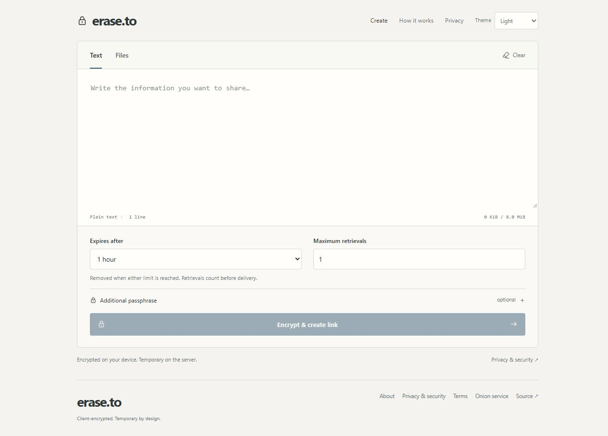
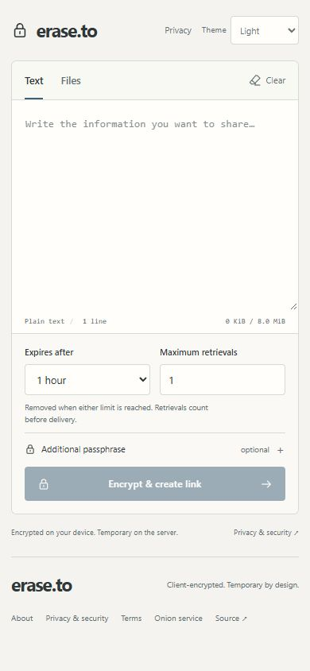
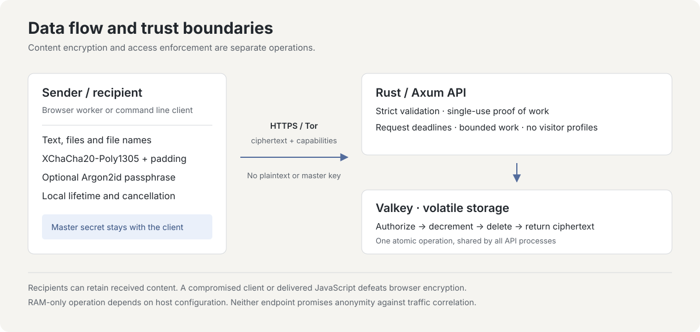

# erase.to

临时分享经过加密的文本和文件。

[English](README.md) · [Deutsch](README.de.md) · [Español](README.es.md) · [简体中文](README.zh-CN.md) · [Português (Brasil)](README.pt-BR.md)

[打开 erase.to](https://erase.to/) · [文档](docs/README.md) · [安全模型](docs/threat-model.md) · [自行部署](docs/operations.md)

erase.to 是由 RedCamel 设计的临时通信工具。这是一个独立的个人项目，由我开发和运营。

隐私不应是付费功能。服务免费使用，无需账号，也没有广告或分析追踪。内容在你的设备上加密后才会上传；服务器将加密数据包保存在易失性内存中。应用不保留访问日志，不根据 IP 地址建立访客画像，界面也不加载第三方脚本、字体或 CDN 资源。

写下消息或添加文件，设置有效期和提取次数上限，然后分享生成的链接。你还可以设置口令，作为另一项访问条件。打开页面即可使用编辑器，无需注册。

<picture>
  <source media="(prefers-color-scheme: dark)" srcset="docs/images/editor-dark.jpg">
  
</picture>

<details>
<summary>手机界面</summary>



</details>

## 功能

| 功能 | 行为 |
| --- | --- |
| 文本与文件 | 内容总量最多 **64 MiB**，其中 UTF-8 文本最多 **8 MiB**，文件最多 **8 个**。文件名和媒体类型也会加密。 |
| 客户端加密 | 使用 XChaCha20-Poly1305、随机生成的链接密钥，以及可选的 Argon2id 口令。输入错误口令不会消耗提取次数。 |
| 限时限次访问 | 有效期和提取次数上限同时生效。共享同一个 Valkey 主实例的多个 API 进程，通过原子操作完成授权检查、计数变更和最终删除。 |
| 发送方控制 | 独立的撤销凭证可以删除服务器上剩余的数据包。该凭证不包含在接收方的链接中。 |
| 本地清理 | 支持手动清理；无操作五分钟后清理，并提前 30 秒提醒；隐藏标签页时清除已解密的内容。 |
| 访问与部署 | 提供浏览器和命令行客户端，可通过 Tor Browser 使用可选的 Tor onion 服务，也可自行部署 Rust、Svelte 和禁用持久化的 Valkey。 |

## 在本地试用

先安装 Git、Docker 和 Docker Compose：

```sh
git clone https://github.com/RedCamel1312/erase.to.git
cd erase.to
docker compose up --build -d
```

打开 `http://127.0.0.1:3001`。Compose 配置仅向这个本地回环地址开放端口；应用和缓存使用内部网络。停止缓存会丢弃其中的数据包。

面向公众部署时，请遵循[运维指南](docs/operations.md)，其中包括 HTTPS 或受支持的 onion 服务浏览器环境、交换空间和内存转储控制、代理缓冲以及主机验证。仅使用容器并不意味着数据只存在于 RAM 中。修改源代码请参阅[开发指南](docs/development.md)。详细技术文档使用英语。

## 需要了解的限制

- 如果没有设置额外口令，持有完整链接即可访问内容。请保护好链接；如果你依赖链接与口令的分离来提供保护，就应通过不同渠道分享它们。
- 次数上限限制的是获得授权的提取，不是阅读人数，也不是成功送达次数。最后一次提取若中途断开，仍可能消耗数据包。接收方可以保留副本，撤销和本地清理无法删除这些副本。
- 缓存重启会丢弃数据包。大型传输会在内存中缓冲完整数据包，可能需要内容大小数倍的内存，并且必须在限定时间内完成。
- 加密无法隐藏所有元数据，也无法保护已被入侵的设备。服务器能看到访问参数和传输信息；浏览器还必须信任收到的代码。源代码审查和测试不等于独立安全审计，也不构成匿名性保证。

[威胁模型](docs/threat-model.md)详细说明了这些边界。

<details>
<summary>协议与存储的工作方式</summary>



浏览器 Worker 和 CLI 共用 `shared/` 中的版本化协议。XChaCha20-Poly1305 加密使用随机生成的 256 位链接密钥和 192 位 nonce。可选口令使用 Argon2id v1.3，内存参数为 64 MiB，迭代三轮。经过认证的元数据将数据包的访问规则与内容绑定；按 4 KiB 大小分档填充可以隐藏精确长度，但大致大小仍然可见。

链接密钥保留在 URL 片段中，浏览器不会把片段包含在 HTTP 请求里。元数据查询、内容提取和撤销分别使用不同的凭证。服务器会收到密文、公开协议字段、访问规则、凭证哈希以及每次访问时提交的相应凭证；在正常协议流程中，它不会收到明文、原始文件名、链接密钥、口令或解密密钥。

Rust API 校验有明确大小和时限约束的请求，以及与数据包绑定的一次性工作量证明。固定的 Valkey 脚本协调过期、提取消耗、撤销和容量控制。所有数据包都有有效期，持久化和自动淘汰均被禁用，容量不足时拒绝新上传。只重启 API、保持缓存运行时，尚未过期的数据包可以继续保留。

具体格式和设计依据见[协议规范](docs/protocol.md)及[设计参考资料](docs/research.md)。

</details>

<details>
<summary>开发、命令行与验证</summary>

使用 Node 24 和 `package.json` 中固定的 pnpm 版本：

```sh
pnpm install --frozen-lockfile
pnpm check
pnpm test
pnpm build
pnpm cli help
```

[开发指南](docs/development.md)介绍 Rust、独立的 Valkey 实例和浏览器开发服务器。[测试指南](docs/testing.md)介绍使用真实缓存、多进程和完整使用流程的验证方法。测试绝不能连接生产缓存。

[CLI 指南](docs/cli.md)说明发送、接收、口令输入和撤销的方法。不要将完整链接、消息内容或口令放入 shell 参数或命令历史。CLI 支持 HTTPS 和用于本地开发的 HTTP；由于未实现 Tor 传输，它会拒绝 onion 地址。访问 onion 服务请使用 Tor Browser。接收的文件不会被自动打开或预览。

主要源码目录包括 `web/`（界面）、`shared/`（协议与密码学）、`server/`（API 与原子缓存操作）、`cli/` 和 `deploy/`。CI 检查应用、真实缓存下的行为和生产容器。完整导航见[文档索引](docs/README.md)。

</details>

## 参与开发或报告问题

[贡献指南](CONTRIBUTING.md)介绍开发和审查要求。请按照[安全政策](SECURITY.md)私下报告漏洞。复现问题时使用虚构数据，不要在 issue 中发布私人链接、消息或访问凭证。

## 支持项目

服务器和域名的费用由我自己承担。如果这个工具对你有帮助，也愿意支持我的工作和运行费用，可以捐赠一些聪。服务仍可免费使用。

比特币（BTC）：

```text
bc1qddfz8u589nvh0gcxdqcz3yltracn9t9qq9jtm7
```

由 RedCamel 创建，采用 [MIT 许可证](LICENSE)。[第三方声明](THIRD_PARTY.md)。
